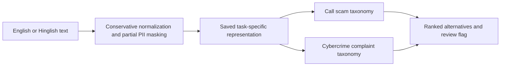

# CyberLens: local English / Hinglish scam classification

[](https://github.com/ChaitanyaKash/CyberLens/actions/workflows/ci.yml)

I’m building CyberLens to classify suspicious messages written in English or Hinglish, including messages with spelling mistakes. This version focuses on text classification; I plan to add retrieval-based guidance and report drafting later.

The main challenge started with preprocessing: an English spellchecker can damage valid Hinglish words. I compared word and character TF-IDF, **Skip-gram with negative sampling implemented in PyTorch**, a custom subword extension, and a fine-tuned multilingual encoder. I also found duplicate messages and contradictory labels, which turned out to matter as much as the choice of model.

I worked in a separate copy of the original project. Both training CSVs are used; `test.csv` is held out for complaint evaluation. Earlier notebooks and stemmed files are kept locally as references, not added as extra training examples.



## Measured results

<!-- RESULTS SUMMARY START -->
The protocols differ, so I list them explicitly. The call result uses the harder family split; the complaint result uses the supplied test file.

| Task | Backend | Evaluation protocol | Macro-F1 | Typo macro-F1 | Accuracy |
|---|---|---|---:|---:|---:|
| call_scam | baseline | 5-fold template-family CV (frozen baseline) | 0.6308 | 0.6337 | 0.7416 |
| complaint | baseline | Supplied test.csv | 0.2345 | 0.2269 | 0.5014 |

[Full comparisons and failure cases](reports/RESULTS.md). Scores are fractions, not percentages.

The optional `robust` call experiment reached **0.8256** clean / **0.7709** typo macro-F1 in nested family CV. I kept it experimental: the approximate paired family-bootstrap interval for its clean improvement includes zero. These are development results, pending fresh independent data.
<!-- RESULTS SUMMARY END -->

The first exact-deduplicated call split scored 1.0000, but related templates were still present on both sides. I replaced that headline with a harder template-family evaluation. This is still a small dataset, not an independent real-world benchmark. English/Hinglish transfer and seven-subtype classification need better labels and more diverse examples.

The English subtype score is still weak. Its baseline test accuracy is 0.5014 and weighted F1 is 0.5081, while macro-F1 is 0.2345 because each class gets equal weight. Training support ranges from 23 to 15,162 examples per class. Three test labels have no trained class, and 130 test templates have conflicting labels. Some frequent classes also perform badly, so imbalance alone does not explain the result. I keep all these test cases in the report.

## Setup from GitHub

Raw complaints, reference notebook outputs, pretrained caches and trained weights are **not distributed in this repository**. Public CI runs the available self-contained tests; private-data/model integration tests explicitly skip when assets are absent.

```powershell
git clone https://github.com/ChaitanyaKash/CyberLens.git
cd CyberLens
py -3.12 -m venv .venv
.\.venv\Scripts\python -m pip install -e .
# Optional neural experiments; choose a CUDA PyTorch wheel using its official installer.
.\.venv\Scripts\python -m pip install -e '.[neural]'
```

Place your own permitted copies of `train.csv`, `test.csv`, and `India_Cyber_Scam_Hinglish_Dataset.csv` in `data/raw/`. Create the `reports/` and `models/` directories if needed, run preparation and training below, then launch the interface. Core installation supports sparse training and inference; PyTorch/Transformers are optional for neural models. A GPU is not needed for sparse inference.

## Start on this laptop

Open PowerShell in this folder:

```powershell
# Open the local desktop classifier (Tkinter; no server or cloud)
.\classify.ps1

# Or use an interactive terminal
.\run.ps1 predict --interactive

# One message, both classification tasks
.\run.ps1 predict --text 'police bol rha hu tumhara beta arrest hai abhi paise bhejo'

# Choose a particular label vocabulary
.\run.ps1 predict --task complaint --text 'Someone sent me a fake UPI payment request'

# Optional experimental call model; it has not passed the default-promotion rule
.\run.ps1 predict --backend robust --task call_scam --text 'police bol rha hu abhi paise bhejo'
```

The launchers use `CYBERLENS_PYTHON` if set, otherwise a local `.venv`, otherwise the existing `anaconda3/envs/NLP` environment under the current user's profile, then `python`. They do not modify an existing environment. Python's WindowsApps alias did not work on the development laptop, so an explicit working environment was used.

## What the two outputs mean

| Task | Training source | Supported labels |
|---|---|---|
| `call_scam` | `India_Cyber_Scam_Hinglish_Dataset.csv` | `none`, `police_digital_arrest`, `police_blackmail`, `other_scam` |
| `complaint` | `train.csv` | 39 parent-category + subcategory combinations, e.g. `Online Financial Fraud :: UPI Related Frauds` |

The Hinglish source has 10,000 rows but only **743 unique texts**. Five original scam labels conflict on identical messages, so I merged `aadhaar`, `amazon`, `bank_kyc`, `lottery`, and `relative` into `other_scam`. The original CSV is unchanged, and the mapping is recorded in `reports/data_audit.json`. The English source has broader complaint labels and **no benign class**, so I treat that output as an incident category, not proof that a message is a scam.

Both models accept English and Hinglish strings, but each source validates its own language/domain. **Reliable seven-subtype classification in both languages needs corrected, aligned training/evaluation data.** Returning both task outputs does not establish cross-language transfer. The interface shows these scope limitations.

## Reproduce training

```powershell
.\run.ps1 prepare
.\run.ps1 train --backend baseline
.\run.ps1 train --backend word2vec --epochs 3 --max-pairs 300000
.\run.ps1 train --backend subword --epochs 3 --max-pairs 300000
.\run.ps1 train --backend hierarchical --task complaint
# Requires public pretrained weights on first use; training/inference stay local.
.\run.ps1 train --backend transformer --task call_scam --epochs 3
.\run.ps1 train --backend transformer --task complaint --epochs 1 --batch-size 32 --accumulation 1
.\run.ps1 train --backend robust --task call_scam
.\run.ps1 train --backend regularized --task complaint
.\run.ps1 train --backend margin --task complaint
.\run.ps1 train --backend semantic --task complaint
.\run.ps1 train --backend ensemble --task complaint
.\run.ps1 train --backend continued --task complaint
python -m unittest discover -s tests -v
python -m cyberlens.template_evaluation
python -m cyberlens.report
python -m cyberlens.challenge
python -m cyberlens.report
```

Run preparation before training and do not change processed splits during an experiment. Fitted vocabularies and classifiers use their training partition only. The nested `robust` experiment uses its own inner/outer family folds over the call development corpus; its deployment artifact is refitted on all development messages after assessment. Models are saved under `models/`; reports under `reports/`. Further tuning needs fresh final evaluation data.

The `robust` experiment requires the locally downloaded public encoder from the transformer setup. It freezes that encoder and compares six fixed candidates with nested family CV. The `regularized` experiment needs a trained complaint baseline and compares three heads without accessing test during selection. Both commands save experimental artifacts; run `python -m cyberlens.report` to apply the recorded promotion rules and regenerate reports. Selecting `robust` for both tasks falls back to baseline for complaints; selecting `regularized` falls back to baseline for calls.

An optional model that failed its promotion rule is marked experimental in prediction output and always requires review, even if its model score is high. The desktop interface shows that status as well.

The `margin` experiment selects one of three combined word/character heads inside the original training split. The `semantic` experiment selects C for a regularised head over frozen encoder features using that same inner partition. The `ensemble` experiment requires the baseline and semantic artifacts and averages their scores with fixed equal weights; it does not tune blend weights. Each needs a clean/noisy validation macro-F1 gain of 0.02 before official-test evaluation. These comparisons reuse a development corpus, so a validation gain still needs independent confirmation.

The `continued` experiment starts from the saved one-epoch complaint transformer, allows at most two additional epochs and stops if validation mean F1 fails to improve by 0.005. It retains the best qualifying checkpoint and only evaluates it on test if it beats the sparse baseline's validation mean by at least 0.02. It keeps separate weights and reports; the earlier one-epoch artifact remains available.

`best` is the default inference backend. After generating reports, it selects the backend for each task using clean and noisy validation macro-F1. Explicit `baseline`, `word2vec`, `subword`, `transformer` and `hierarchical` options remain available for comparison. The financial expert did not beat the baseline's selection score, so it is not the default. Transformer inputs are truncated at 192 subword tokens; this can miss evidence in long complaints.

Alternatively, `.\reproduce.ps1` runs these dependent steps in order and saves a complete console transcript to `reports/reproduction.log`.

For an alternative environment, install `requirements.txt` into your own virtual environment. Select a CUDA-compatible PyTorch wheel using the [official installer](https://pytorch.org/get-started/locally/) if GPU acceleration is required. Baseline inference needs NumPy, pandas, scikit-learn and joblib; PyTorch is needed only for embedding training/tests. `reports/environment.json` records the actual tested package versions.

## Read these next

- `INTERVIEW_GUIDE.md`: detailed mechanisms, decisions, failures, caveats and interview questions.
- `reports/RESULTS.md`: measured comparisons and test results generated from JSON artifacts.
- `reports/data_audit.json`: row counts, exclusions, labels, source hashes and mapping.
- `reports/call_label_conflicts.csv`: hashed template IDs and conflicting label sets; no message text.
- `reports/manual_challenge.json`: hand-authored diagnostic examples and predictions, including failures.
- `reports/call_family_evaluation.json`: the harder grouped call evaluation, family counts and fold coverage.

## Repository map

| Path | Purpose |
|---|---|
| `cyberlens/` | Data preparation, classifiers, custom embeddings, encoder training, inference and GUI |
| `tests/` | Language preservation, masking, split separation, gradients and local inference |
| `.github/workflows/ci.yml` | Core package installation and available tests on Python 3.12 |
| `INTERVIEW_GUIDE.md` | Mechanisms, decisions, failed experiments, limitations and interview questions |
| `reports/` | Aggregate metrics and a transparent development diagnostic |

RAG and grounded report generation are future work; the current milestone is text classification.

## Privacy and inference limits

Processing and inference are local. Rule masking handles selected structured identifiers, not all names/addresses or all identifier formats. Copied raw files and reference notebooks remain sensitive. Never upload this folder as a public dataset. Original text and unsafe Python serialization artifacts are excluded by `.gitignore`. Only load trusted local `.joblib` models.

Scores are uncalibrated. `needs_review` uses a heuristic 0.55 threshold and feature coverage; it does not reliably detect all out-of-distribution input. Placeholder replacement is not certified anonymization. There is no RAG or automatic reporting in this version.

The review flag also checks class-level evaluation evidence. Weak or sparsely evaluated complaint subtypes fall back to a broad suggested category with a review note. This is a practical triage rule, not calibrated certainty. The complaint test contains three label combinations absent from training; those remain in the reported test metrics as unsupported classes.
