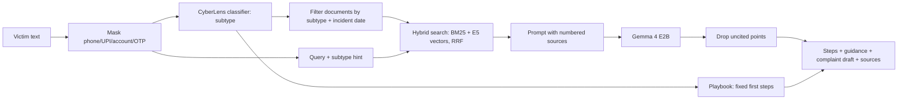

# Guidance RAG (Agent 3)

Given a victim's message, the subtype predicted by the CyberLens classifier, and the incident date, the RAG layer returns:
- **immediate steps**: fixed, verified first actions for that fraud family (1930, bank reporting deadlines, Ombudsman);
- **guidance**: an LLM answer that may only use retrieved official passages and must cite them;
- **a complaint draft** with placeholders and the legal provisions present in the corpus;
- the **sources** behind every point.



## Design choices
| Choice | Why |
|---|---|
| Curated corpus of official RBI, MHA/I4C, DoT, SEBI, CERT-In and legal texts (`rag_corpus/manifest.json`) | Authoritative and citable; crawling everything adds noise |
| Section-aware chunks (~280 words) with a `[issuer \| title \| para]` header | One rule stays in one chunk; the header tells the encoder where the text comes from |
| Filter by predicted subtype and `effective_from/to` | Uses the classifier's output; a 2026 incident gets the 2017 liability rules, a 2027 incident the 2026 amendment |
| Hybrid BM25 + vectors with Reciprocal Rank Fusion | Vectors handle Hinglish paraphrases; BM25 handles "66D", "1930", "14448" |
| `intfloat/multilingual-e5-small` (118M, 384-dim) | Hindi/Hinglish queries, small enough for a phone |
| Gemma 4 E2B | Edge model with LiteRT-LM builds for Android; the same model runs via Ollama on a laptop |
| Fixed playbook for first steps | Time-critical advice (call 1930, report within 3 or 5 days) never depends on the LLM |
| Citation check on LLM output | Points without a valid `[S#]` are dropped |
| LLM chosen by measurement | Gemma 4 E2B, Qwen 2.5 1.5B and Phi-4-mini are compared on the same questions (`modal_app::answers --model ...`) |
| Masking before retrieval and generation | Phone numbers, UPI IDs, account numbers and OTPs never reach the prompt |

## Usage
```powershell
pip install -e ".[rag]"                       # pymupdf, beautifulsoup4, sentence-transformers
python -m cyberlens.rag build                  # local build (CPU is fine for e5-small; ~600 chunks)
modal run -m cyberlens.rag.modal_app::build    # or: embed on a Modal GPU
python -m cyberlens.rag eval                   # Recall@5 / MRR -> reports/rag_eval.json
ollama pull gemma4:e2b
python -m cyberlens.rag ask "UPI se 15000 kat gaye" --date 2026-11-02
python -m cyberlens.rag ask "..." --subtype "Online Financial Fraud :: UPI Related Frauds" --llm none
modal run -m cyberlens.rag.modal_app::answers  # LLM answers for the eval questions on a Modal GPU
python -m cyberlens.rag export-mobile          # models/rag_mobile/ for the Android app
```
`--embedder hash` builds a model-free index for tests.

Tracing (optional): `pip install arize-phoenix`, run `phoenix serve`, then set `CYBERLENS_TRACE=1`. Each answer shows up at http://localhost:6006 as a `guidance` span with `retrieve` (documents and scores) and `llm` (prompt and raw output) children. Only masked text is recorded.

## Android
`export-mobile` writes:
- `chunks.json`: chunk text and metadata;
- `embeddings_f16.bin`: `chunks x dim` little-endian float16, already L2-normalised;
- `bm25.json`: `k1`, `b`, average length, idf and per-chunk term counts;
- `config.json`: subtype → documents map, effective dates, the playbook for every subtype and rule regime, and the system prompt.

On the phone:
1. Run the existing classifier → subtype.
2. Embed `"query: " + text` with multilingual-e5-small converted to ONNX (ONNX Runtime Mobile) or LiteRT. Score = dot product with the matrix.
3. Compute BM25 from `bm25.json`, then fuse the two rankings: `1 / (60 + rank)`.
4. Show the playbook steps immediately; then run Gemma 4 E2B (`.litertlm` build via LiteRT-LM, Kotlin API) with the same prompt and drop uncited points.
Everything stays on the device; nothing is sent to a server.

## Limits
- Retrieval scores come from 40 hand-written questions with document-level labels; treat them as a sanity check, not a benchmark.
- If the victim was tricked into sending the money themselves, even the 2026 rules may not cover it; the prompt forbids promising refunds.
- Legal provisions in the complaint draft are suggestions for the police to verify.
- The cybercrime.gov.in reporting guide could not be downloaded automatically; the 1930/NCRP steps come from PIB releases.
